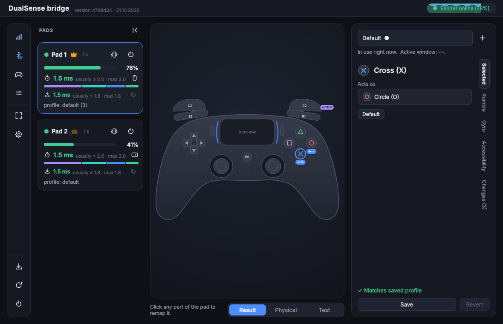

# DualSense bridge

**English** | [Polski](README.pl.md)

> **Work in progress.** This is not a stable program yet: expect bugs and breaking changes.

DualSense bridge sends input from a PS5 pad (DualSense) to a Windows PC over the local network. On the PC the pad
shows up as a regular DualSense (with HIDMaestro) or a PS4 pad (with ViGEmBus): buttons, sticks, gyro, touchpad, and
in the other direction rumble and the lightbar.

The pad connects over Bluetooth to the **sender**, a small Linux device nearby, e.g. a Raspberry Pi or an old phone
running postmarketOS. The sender forwards every change of the pad's state to the PC immediately. This way the PC can
sit in another room while you play from the couch in front of the TV.

The PC has a window that controls everything, including from the pad itself:
- switching picture and sound to the TV with a single shortcut (console mode),
- remapping buttons, sticks and gyro, with per-pad and per-game profiles,
- touchpad as a mouse,
- pairing pads with the sender without walking over to it,
- a master pad that is allowed more (e.g. when kids are playing).



More screenshots: [docs/FEATURES.md](docs/FEATURES.md#screenshots).

```
DualSense ──Bluetooth──> sender (sender/) ──network, UDP 5005──> PC (receiver/) ──> virtual DualSense / DS4 ──> games
                                                                        └──> DSU server (gyro for emulators)
```

## What you need

| | PC | Sender |
|---|---|---|
| Hardware | a Windows 10 / 11 computer | Raspberry Pi, an old phone with postmarketOS, or another Linux computer with Bluetooth |
| Software | [Python 3.11+](https://www.python.org/downloads/), [Git for Windows](https://git-scm.com/download/win), [.NET 10](https://dotnet.microsoft.com/download/dotnet/10.0) (for HIDMaestro) | Python 3.11+, `git`, BlueZ, systemd, a kernel with the `hid-playstation` driver |
| Network | the same local network as the sender | preferably a cable (Ethernet); Wi-Fi works but causes latency spikes |
| Bluetooth | - | built-in is enough; a USB dongle (e.g. TP-Link UB500) often has noticeably lower latency - the sender picks it automatically |

## Pad support

What works from the PS5 pad (DualSense) and what is still missing.

| Pad part | Status | Notes |
|---|---|---|
| Buttons (face, L1/R1, L3/R3, D-pad, Create, Options, PS) | ✅ | remapping, per-pad and per-game profiles |
| Analog sticks | ✅ | remap, deadzones, curves, drift test |
| Triggers L2/R2 (analog value) | ✅ | remapping and threshold tuning |
| Gyro and accelerometer | ✅ | DSU for emulators, aiming, tilt as a stick, calibration |
| Touchpad (click, 2 fingers) | ✅ | DS4 touch or mouse (cursor, scroll, right button) |
| Battery and charging | ✅ | level, warning, lightbar colour by battery |
| Lightbar | ✅ | own colour per pad or the game's colour |
| Rumble (2 motors) | ✅ | through the driver and HID at the same time |
| Adaptive triggers | ✅ | resistance, click, vibration; from the profile or from the game (HIDMaestro) |
| HD haptics (real ones, not 2 motors) | ✅ | opt-in, from the game's audio (HIDMaestro composite pad), per pad; needs sender v13+ |
| Pairing and switching the pad off | ✅ | from the PC window, no need to walk to the sender |
| Mute button and its LED | ✅ | the button reaches the PC as the DualSense's mute button, the LED follows what the game / program sets; needs sender v15+ |
| Microphone | ❌ | |
| Speaker | ✅ | experimental, opt-in, the game's sound plays on the pad's speaker over Bluetooth (Opus); needs sender v14+ with libopus, master pad only |
| Headphone jack | ❌ | |
| Player LEDs (under the lightbar) | ✅ | follow what the game sets; needs sender v15+ |
| DualSense Edge (back buttons, Fn) | ❌ | |

## Installation

### 1. PC (Windows)

In PowerShell or Command Prompt:

```
git clone https://github.com/matt400/dualsense-bridge
cd dualsense-bridge\receiver
pip install -r requirements.txt
python receiver_controller.py --autostart on
python receiver_controller.py
```

- **Virtual pads:** the receiver downloads and updates [HIDMaestro](https://github.com/hifihedgehog/HIDMaestro)
  (native DualSense, actively developed) by itself (~56 MB, shortly after the first start). The receiver runs
  **as administrator** (HIDMaestro can only create pads that way). The UAC prompt appears only on the first start:
  after that the receiver starts through a Task Scheduler task with highest privileges (`DualSenseBridgeAdmin`, same
  for autostart). `--no-elevate` turns off just the elevation.
- Fallback: the `vgamepad` installer will offer the **ViGEmBus** driver (PS4 pad). Install it. Without HIDMaestro or
  without administrator rights the receiver uses ViGEmBus. Choice: Settings → Pads.
- On the first start Windows Firewall asks for network access. Allow it on **private networks** (UDP 5005).
- `--autostart on` starts the receiver right after you log in to Windows (`--autostart off` turns it off).
- The receiver lives in the system tray. Click its icon to open the window.
- Note the PC's IP address (`ipconfig` → "IPv4 Address", e.g. `192.168.1.10`). The sender will need it.

### 2. Sender (Linux)

Raspberry Pi OS / Debian / Ubuntu:

```
sudo apt install python3 python3-evdev bluez git
git clone https://github.com/matt400/dualsense-bridge
cd dualsense-bridge/sender
cp sender.example.toml sender.toml
nano sender.toml                        # uncomment and set: host = "PC's IP"
sudo ./install-service.sh
```

postmarketOS / Alpine: `doas apk add python3 py3-evdev bluez git`, and `doas` instead of `sudo` in the other commands.

The sender runs as a systemd service and starts by itself when the device boots. Log: `journalctl -u dualsense-sender -f`.
Removing the service: `sudo ./install-service.sh --remove`.

### 3. Pad

1. In the window on the PC click the **Bluetooth** icon in the side menu, then **Scan**.
2. On the pad hold **Create + PS** until the lightbar starts blinking fast.
3. Click **Pair** next to the pad in the list.

After that just turn the pad on with the PS button and it connects by itself. It appears in the window and in games
as a DualSense (HIDMaestro) or a PS4 pad (ViGEmBus). Player order is fixed: pad 2 won't become player 1, even if you
turn it on first.

## First steps

- **Pad shortcuts:** the pad icon in the side menu shows all shortcuts (e.g. PS + Share = screenshot).
- **Console mode** (picture and sound on the TV): in Settings → Console mode pick the TV and PC audio devices. Then
  pressing R2 twice on the pad switches the screens.
- **Remapping:** click a button or stick on the pad drawing in the window. **Save** stores the profile.
- **Full screen** (F11 or the icon) is TV mode: a larger window you control with the pad.

## Updating

The **Update** button in the window gets the new version on both the PC and the sender (`git pull`) and restarts
both sides. Settings and profiles are kept, and the receiver makes a backup of them (Settings → Backups).

## Problems

Most common:
- **The pad doesn't show up in games:** Settings → Pads shows what is missing (HIDMaestro, administrator rights
  or ViGEmBus).
- **"Sender offline" in the window:** wrong `host` in `sender.toml`, Windows Firewall (UDP 5005), or the sender is on
  a different network.
- **Latency spikes:** the sender is on Wi-Fi. Connect it with a cable.

On a network shared with others set the same `key` on both sides: [docs/SECURITY.md](docs/SECURITY.md).

Full list: [docs/TROUBLESHOOTING.md](docs/TROUBLESHOOTING.md).

## More

- [docs/FEATURES.md](docs/FEATURES.md) – all features of the window, console mode, master pad, Wake-on-LAN and the Test view
- [docs/CONFIGURATION.md](docs/CONFIGURATION.md) – settings files (`sender.toml`, `receiver.toml`, `console.json`) and updating
- [docs/SECURITY.md](docs/SECURITY.md) – HMAC key, replay protection, what runs with which rights
- [docs/DEVELOPMENT.md](docs/DEVELOPMENT.md) – code structure and tests

## License

[MIT](LICENSE)
