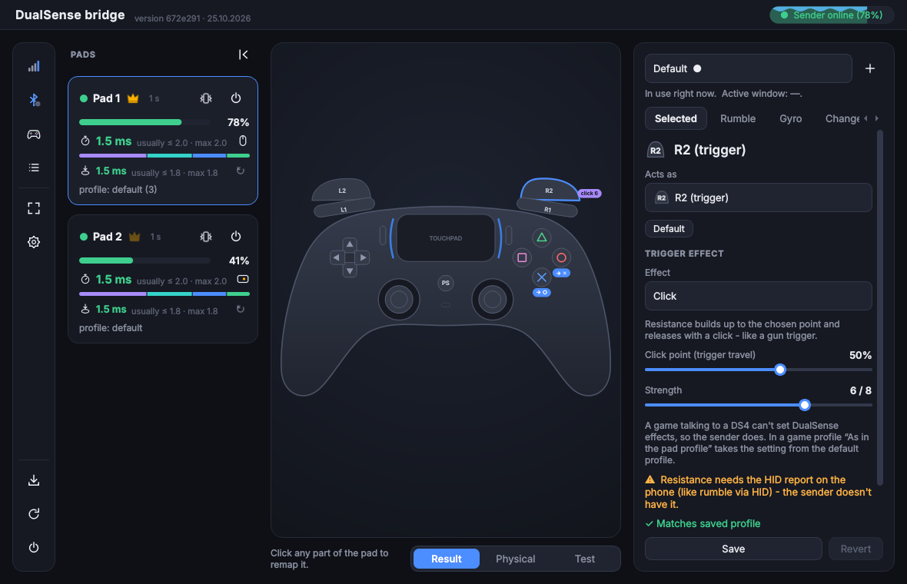
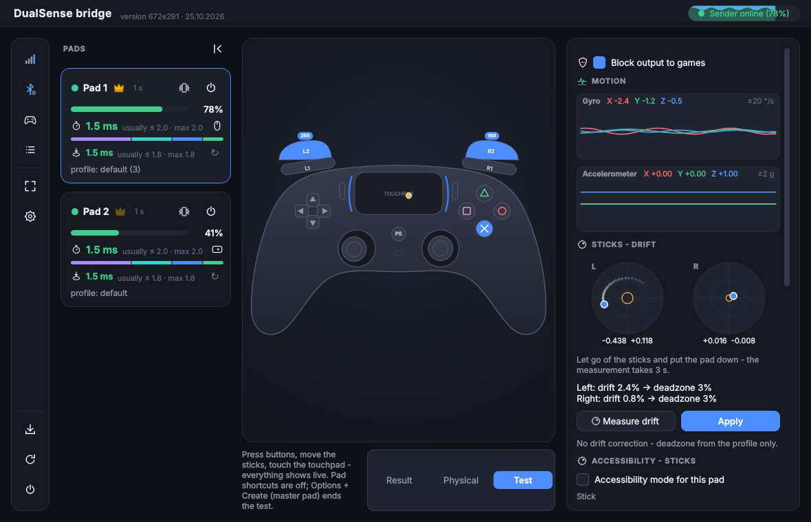
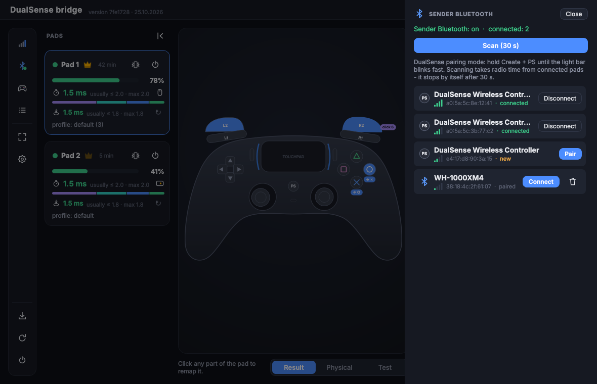
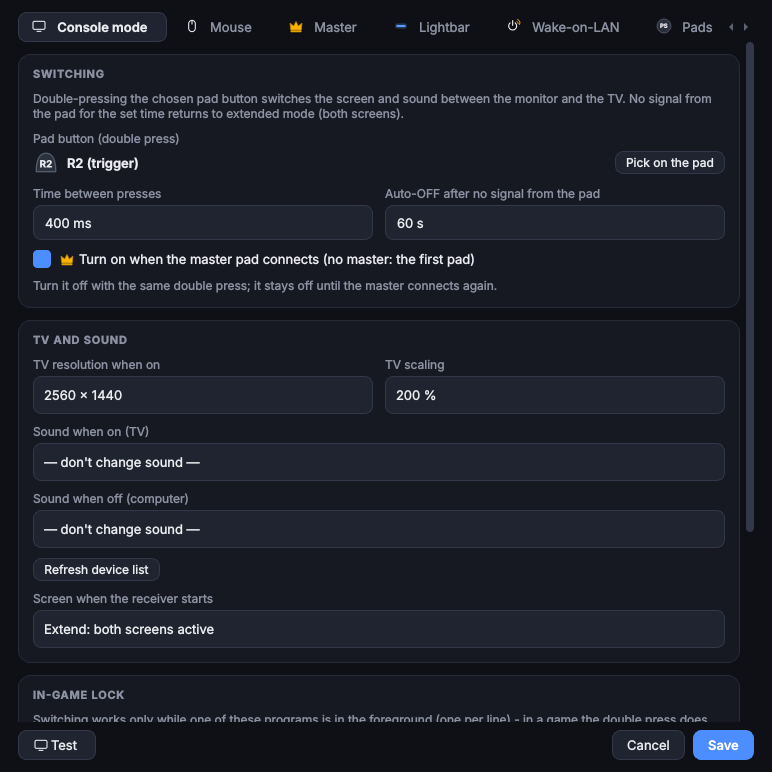
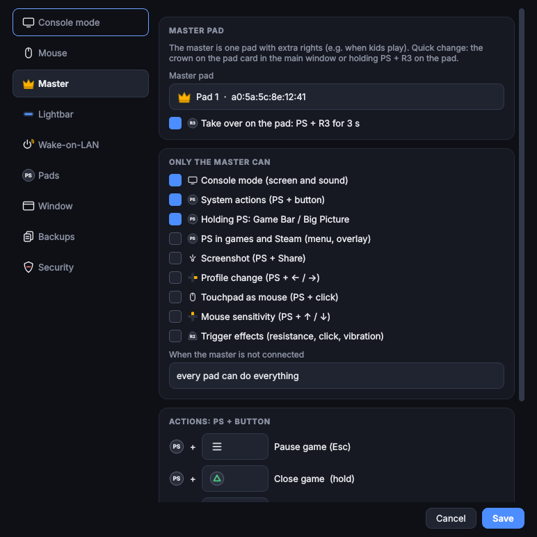

# Features

**English** | [Polski](FUNKCJE.pl.md)

- **Virtual DualSense** (HIDMaestro) or **DS4** (ViGEmBus) with buttons, sticks, triggers, touchpad, gyro, rumble
  and the lightbar colour from the game. Settings → Pads: `auto` (HIDMaestro when the DLL is present and the receiver
  runs as administrator, otherwise ViGEmBus), `hidmaestro` (the same, but a missing HIDMaestro is a warning in the
  event log) or `vigem`. HIDMaestro downloads and updates itself from GitHub (only the DLL from the release zip, via
  HTTP Range), and the receiver starts as administrator (UAC; autostart task with highest privileges). The change takes
  effect immediately (pads are recreated). A HIDMaestro error while creating a pad = that pad goes through ViGEmBus
  and a warning in the event log. The pad card (touchpad icon) shows what kind of pad the slot is.
- **DSU server (Cemuhook)** with motion and touch for emulators (Cemu, Yuzu/Ryujinx, Dolphin) on this PC; an emulator
  on another device needs `dsu_bind = "0.0.0.0"`.
- **Touchpad as mouse:** cursor, tap = left button, two-finger scrolling, two-finger tap = right button.
  Toggle: PS + touchpad click. A physical click doesn't move the cursor: movement from the last ~80 ms before the
  click is undone, the cursor stays still for ~150 ms after pressing and releasing, and dragging with the click held
  starts only after a clear finger movement. Sensitivity and these timings: Settings → Mouse (takes effect immediately).
- **One window for everything** (PySide6, tray icon):
  - on the left, pad cards: battery, **real pad → game latency** (average, "usually ≤" = 95 out of 100 samples, and
    max over 5 s, with a segment bar: Bluetooth / sender / network / PC), below it **button → game** (the same for
    presses only - last 100, with reset), active profile, rumble test, pad power-off, master crown; ping, packet loss
    and Hz in the tooltip; a disconnected pad shows just its name;
  - **event log** at the bottom of the window (list icon in the header): pad connections and disconnections, sender
    online / offline, master change, console mode, errors, updates, low battery; level filter (everything / warnings
    and errors / errors only), line limit, copy, clear (two clicks). The sender icon turns on **sender events**
    (off by default): pad connecting to the sender, Wake-on-LAN sent, lost contact with the receiver, errors - the
    sender keeps them while the receiver doesn't answer, so e.g. Wake-on-LAN appears after the PC starts with the real
    time. The log is in memory only (a restart clears it); the panel height can be dragged;
  - in the middle, a live pad drawing: click a button, trigger or stick to remap or tune it;
  - on the right, the profile (default / per game), the **Selected**, **Gyro**, **Changes** tabs and the **Save**
    button (Ctrl+S);
  - remapping buttons and sticks, gyro aiming (right stick / mouse); deadzones, curves and anti-deadzone in the
    collapsible "Advanced" section (it opens by itself when something in it was changed);
  - **Pad tilt as a stick** (the bottom of the **Gyro** tab; the stick in the pad drawing moves with the tilt): tilting the pad drives an analog stick (or the d-pad), per pad (saved by MAC in `gyrostick.json` next
    to `remap.json`, applied immediately - not part of the profile). Front down = stick up, left / right = stick left /
    right, full 360° range. Settings: deadzone, max outer zone, smoothing (EMA), vertical / horizontal ratio, response
    curve (linear / cubic / aggressive), invert pitch / roll, clutch button (tilt works only while it is held), auto-sleep
    after the pad lies still, a button pressed at full tilt (e.g. L3 to sprint), center calibration and a live 2D
    preview with raw and filtered values. Returning to the deadzone zeroes the stick at once (no filter lag), small
    changes are not sent, and the stick is released when the foreground window changes, the pad drops out, the
    profile changes or the feature is switched off. Optionally the pad signals reaching full tilt (firm rumble tick /
    orange flash) and coming back to the deadzone (light tick / cyan flash) - rumble, lightbar colour or both;
  - **trigger effects** (adaptive triggers) L2 / R2 in the profile: **resistance** (strength 1-8, from which point of
    travel), a **click** like a gun trigger (point at 20-70 % of travel and strength) or **vibration** (from which
    point, strength, frequency). A game going through a virtual DS4 can't send this, so the sender sets it with a HID
    report. A game profile can override them or leave them "As in the pad profile"; in Settings → Master they can be
    reserved for the master only;
  - **game rumble on the triggers** (a stand-in): L2 vibrates like the large motor, R2 like the small one, with
    adjustable strength and frequency; while rumbling it replaces the trigger effect, after a moment of quiet the effect
    returns. The sender computes it from the same rumble packets - no extra network traffic. Click, vibration and game
    rumble require sender v8 (older ones get resistance only);
  - **trigger effects from games**: a game with DualSense support sets them on the virtual DualSense (HIDMaestro), and
    the receiver passes them to the pad unchanged (every mode the game sends). On a trigger with an effect in the
    profile the profile wins; when the game controls the triggers itself, game rumble on the triggers is off. They work
    in every program (Steam too), stay through alt-tab and disappear when the program that set them closes or the pad
    disconnects. The master feature "Trigger effects" covers them too. They require sender v11; the first effect from
    a game goes to the event log;
  - per-game profiles (`game.exe`) that switch on by themselves when the game is the active window;
  - changes apply to the pad immediately, saving to `remap.json` is separate;
  - irreversible actions (pad power-off, profile deletion, reset, receiver restart) require a second click;
  - an icon-only header (full screen, settings, update, restart, quit - description in the tooltip);
    **Restart** is also in the tray menu;
  - **full screen = TV mode:** a larger interface (readable from the couch) and controlling the window with the pad
    while the window is active: D-pad - navigation, ✕ - select, ○ - back / leave full screen, L1 / R1 - previous / next
    pad, PS held - regular shortcuts;
  - pad buttons shown as icons (with the full name in the tooltip);
  - **Pad shortcuts** (pad icon in the header): a panel sliding in from the right with all pad shortcuts, built from
    the current settings (console mode button, master actions, long PS); crown = master pad only. In TV mode:
    D-pad to the icon, ✕ opens, D-pad scrolls, ○ closes;
  - **sender Bluetooth from the window** (a sender behind the TV doesn't need a screen): the Bluetooth icon in the
    header with a status dot (green - working, blue - scanning, yellow - off, red - error, grey - no data) opens a
    panel sliding in from the right: **scanning** (with a countdown, stops by itself after 30 s - scanning takes radio
    time from connected pads), a device list (pads on top, signal strength during the scan, state) and the buttons
    **Pair** (pairing, trust and connection), **Connect**, **Disconnect**, **Forget**, and with the adapter off
    **Turn Bluetooth on**. In TV mode: D-pad to the icon, ✕ opens, D-pad moves only within the panel, ✕ clicks,
    ○ closes. DualSense pairing mode: Create + PS until the lightbar blinks fast. Requires sender v10 (systemd:
    `busctl`, BlueZ: `bluetoothctl`);
    **Bluetooth controller**: a list of all of the sender's Bluetooth modules with the device name (e.g.
    "Qualcomm WCN3990", "Realtek TP-Link UB5A Adapter"), type (built-in / USB dongle), hciN number and state; **Use**
    picks a module permanently (remembered by device, not by number). **Auto** - USB dongle before built-in;
    **Manual** - the sender changes nothing. Unselected ones are turned off (rfkill), the selected one runs without
    SNIFF mode (the pad doesn't put the link to sleep); plugging in / removing a dongle without a restart. Default
    mode: `bt_adapter` in `sender.toml`;
  - **Test view** (the third switch under the pad: Result / Physical / Test) for the selected pad:
    - on the drawing, live buttons, trigger values (0-255), sticks, fingers and the touchpad click (also in mouse mode);
    - on the right, gyro [°/s] and accelerometer [g] charts (3 axes, last 5 s, auto-scaling) and the position of both
      sticks on a square-root scale (drift around 1-2 % is clearly visible);
    - **stick drift:** "Measure drift" - sticks released for 3 s (the sender disables its deadzone for that time,
      otherwise it would clip deviations to ~2 %), result: the largest deflection at rest and a suggested deadzone
      (×1.25, rounded up to 1 %, min. 3 %); "Apply" saves it immediately as the **pad drift correction**
      (`receiver/padcal.json`, per MAC). It works in all profiles of this pad, game profiles too, as the minimum
      deadzone (a larger one from the profile stays) and follows the physical stick when sticks are swapped;
    - **gyro calibration:** the pad lies still for 3 s, the sender computes the offset and saves it on the sender per
      pad (`sender/gyro_cal.json`); a calibrated pad no longer calibrates when the sender starts (no need to put it
      down then), autobias still fine-tunes the offset in memory. Requires sender v9;
    - during the test the game gets a neutral state of the tested pad (the "Block output to games" switch, on by
      default): buttons, sticks, motion and touch don't reach the game, touchpad mouse, gyro mouse, PS shortcuts and
      console mode don't react. The block works only while the receiver window is active: it goes away when you
      switch to the game (another window in the foreground), leave the Test view, minimise / hide the window or close
      the receiver;
    - in TV mode the tested pad doesn't control the window; holding ○ for 1 s leaves the test;
    - with the Test view open **no pad triggers shortcuts** (PS + button, master actions and takeover, console mode,
      PS + touchpad click) - testing buttons won't toggle anything;
    - **emergency exit from the pad: Options + Create** (pressed together) on the master pad (without a master in
      the settings - on any pad) ends the test without a mouse, also with the window hidden and when the master itself
      is being tested: the block goes away immediately, and buttons held at that moment are sent to the game as
      released until you let go of them. Without PS - long PS + △ used to turn the pad off.
- **PS shortcuts:**

  | Shortcut | Action |
  |---|---|
  | PS + Share | screenshot |
  | PS + d-pad up / down | mouse sensitivity |
  | PS + d-pad left / right | profile change |
  | long PS | Xbox Game Bar or Steam Big Picture |

  PS already held when the pad connects (turning the pad on by holding PS) doesn't open Game Bar and doesn't go to the
  game. The receiver disables opening Game Bar with the pad button (Windows treated PS as the Xbox button), and when
  Game Bar isn't installed, `ms-gamebar` links get a silent handler - no "Select an app" dialog pops up.

- **Console mode:** double-clicking the chosen pad button (**R2** by default) switches picture and sound between the
  monitor and the TV. R2 counts only when pressed deep (with hysteresis - a trembling trigger doesn't produce a double
  click) and only on its own: R2 together with another button (typical in a game) doesn't switch. **When the master
  pad connects, the mode turns on by itself** (`auto_on_master`); a double R2 turns it off and it stays off until the
  master connects again. Restarting the receiver from the window keeps the mode state. An old `console.json` with
  PS / mute changes to R2 by itself.
  **The mode doesn't switch in a game:** double R2 works only when a program from the `allowed_apps` list is in the
  foreground (desktop, Steam / Big Picture, launchers - the list is editable in Settings); in a game double R2 is
  simply ignored (no flash - it's normal gameplay), and turning it on when the master connects waits until the game
  leaves the foreground.

  | | Display (`SetDisplayConfig`, fallback `DisplaySwitch.exe`) | Sound | Notification |
  |---|---|---|---|
  | ON | TV only (`/external`), on the TV 2560×1440 and 200 % scaling (`tv_width`, `tv_height`, `tv_scale`) | `audio_tv` | "Console mode on" |
  | OFF | both screens (`/extend`) | `audio_pc` | "Console mode off" |
  | no packets from the pad for `timeout_s` | as OFF | as OFF | as OFF |
  | PC shutdown / sleep (master action, Start, Big Picture) | as OFF, before shutting down | as OFF | none |
  | receiver start (autostart at logon) | `startup_mode`: `extend` (both screens) or `internal` | `audio_pc` | none |

  At start both screens are active by default, so you're never left without a picture. Closing the receiver normally
  with console mode on returns to extend, as does shutting down Windows (Windows remembers the screen layout - without
  this, after a start the picture, including the login screen, would be on the TV only). A display, sound or
  notification command error goes to the log and doesn't stop anything.
- **Master pad** (e.g. when kids are playing): selected features work on one pad only - console mode, system
  actions, long PS, PS in a game / Steam, screenshot, profile change, mouse, sensitivity. Another pad gets a red
  lightbar flash. The master is assigned to the pad (MAC), not to the slot. Quick change: the crown on the pad card or
  **PS + R3 held for 3 s** on the pad (gold flash; can be turned off). **Touchpad as mouse follows the master:**
  the master's touchpad controls the cursor, the other pads have DS4 touch (each pad can still toggle with PS +
  touchpad click); when there is no master or it isn't connected - according to `mouse_pads`. Master system actions:

  | Default | Action |
  |---|---|
  | PS + Options | pause the game (Esc) |
  | PS + △ (hold ~1 s) | close the game (doesn't close the desktop or Steam) |
  | to be set | put the PC to sleep, shut down the PC (10 s for `shutdown /a`) |

  The button from the combo (and PS itself) doesn't reach the game. PS shortcut buttons (Share, D-pad) and R3 can't
  be used for actions. When the master isn't connected: anyone can (default) or nobody.
- **Settings** (tray icon → Settings, or the button in the window), seven tabs:
  - **Console mode:** you pick the pad button by pressing it on the pad, times are number fields, audio devices are
    lists of active Windows outputs, "Test" turns the mode on for 10 s with the values from the window. Changing console
    mode saves `console.json` and restarts the receiver (unsaved remap profile changes are lost);
  - **Mouse:** sensitivity and touchpad click stabilisation;
  - **Master:** the master pad, what only it is allowed, action buttons. Mouse and master take effect immediately,
    without a restart (`settings.json`);
  - **Lightbar:** colour per pad / default, mode, blinking, low battery threshold (immediately);
  - **Wake-on-LAN:** enable, the button paired with PS, hold time, MAC and broadcast (empty = automatic);
  - **Window:** the screen the window appears on (always centred; when the screen is missing - on an available one),
    window or full screen (also F11 and the header button), language: Polski / English (takes effect after a restart).
    After switching screens (console mode, TV resolution / scaling) the window returns to the centre and fits the
    screen (shrunk on the TV, back to its own size on the monitor). A pad connecting brings the window to the front -
    but not during a game (the same program list as in Console mode);
  - **Backups:** backups of `settings.json`, `console.json` and `remap.json` made on update (last 5, in
    `receiver/backups/`) or manually. "Restore" (two clicks) first saves a backup of the current files - so it can be
    undone too - and then restarts the receiver;
  - **Security:** what to fix (no HMAC key, DSU reachable from the network, receiver or Python folder writable
    without administrator rights), **Copy a new key** (random key to the clipboard) and **Secure folder**
    ([SECURITY.md](SECURITY.md)).
- **Lightbar** (Settings → Lightbar), separately for each pad (MAC) or as the default for all:
  - **the game has priority only in a game** - outside a game (desktop, Steam / Big Picture, launchers - the same
    program list as in Console mode) your own colour always shows, even when Steam sets its own; in a game the game's
    colour replaces yours. The **"A game can change the colour"** option off = always the colour from settings. The
    first colour from the PC goes to the event log;
  - **solid colour** mode (colour picker; empty = `idle_lightbar`) or **colour by battery** (red at the threshold →
    yellow → green from 80 %);
  - **red blinking on low battery** - also in a game (over the game's colour), not while charging; with a red base
    colour it blinks red / off;
  - shortcut confirmations (master's gold flash, profile, mouse) are always on top;
  - the **low battery threshold** is shared with the warning on the pad card and the notification (`low_batt` from
    toml is only the initial value).
- **Wake-on-LAN from the pad** (Settings → Wake-on-LAN): when the PC doesn't respond (off / asleep), **PS + Options
  held ~1 s** (button and time configurable) - the sender sends a magic packet. With the PC running the same combo goes
  to the receiver as usual (e.g. master pause), so nothing collides; long PS alone isn't suitable (that's how the pad
  is turned on). The pad confirms with a white flash and rumble, an error (e.g. unknown MAC) - with a red one.
  - The PC's MAC: entered in the window or **automatic** - the sender reads it from its ARP table while the PC is
    running and remembers it; broadcast address: entered, or the network broadcast towards the PC + `255.255.255.255`;
    the packet also goes directly to the PC's IP. The window shows what the sender will use.
  - The settings are sent to the sender (every 5 s and on change) and saved on the sender in `sender/wol.json` - with
    the PC off there's nowhere else to get them from.
  - The PC must have Wake-on-LAN enabled in BIOS / UEFI and in the network card properties (Power Management:
    "Allow this device to wake the computer", "Only allow a magic packet to wake the computer"); preferably over a
    cable - over Wi-Fi it usually doesn't work.
- **Pad power-off** from the PC or automatically after inactivity (15 min by default).
- **Pad → game latency** (average, "usually ≤" = 95th percentile, max; bar = segment averages) measured for every
  change of the pad's state (button, stick, motion), from the moment the sender's kernel received the report from the
  pad until the report is handed to the virtual DS4. The sender knows the PC clock from ping replies (like NTP, the
  sample with the lowest RTT), so the network is measured one-way, not as half the ping. Segments: **Bluetooth** -
  radio latency above the best case over 2 s (pad timestamps; the constant part of ~1-2 ms can't be measured),
  **sender** - kernel → send, **network**, **PC** - receive → virtual pad. With an older sender the card shows ping
  only; an older receiver gets regular packets from a new sender.
  **Button → game** is the same measurement only for button, D-pad and trigger changes (crossing the press
  threshold, no sticks or gyro): the last 100 presses / releases with no time limit (presses are rare - 5 s would give
  only a few samples), cleared when the pad in the slot changes or with the ↻ icon on the card.
- **Rumble:** simultaneously through the driver (evdev FF) and directly with a HID report via `/dev/hidrawN`
  (sender as root), with flags depending on the pad's firmware, the lightbar colour in the same report; the `rumble`
  setting in `sender.toml`. The pad card shows "rumble: driver + HID" or the reason it's missing (no permission /
  missing in kernel / pad not found / old sender). The rumble button on the pad card checks whether rumble reaches
  the pad.
- **Fixed player order:** the sender remembers which pad (MAC) was in which slot (`slots.json`), and the receiver
  plugs in virtual pads in slot order. When pad 2 connects alone, slot 1 first gets a **placeholder pad** (neutral
  state), so games and Steam (also without Steam Input) always see pad 2 as player 2. Pad 1 then takes over the
  placeholder without replugging, and the placeholder goes away together with the last pad from a higher slot.
  Disabling: Settings → Pads → "Fixed player order". HIDMaestro also creates pads with a fixed slot identity (the same
  device paths after every plug-in).
- **Low latency:**
  - buttons sent immediately, with repeats in case a packet is lost,
  - sticks, motion and touch without delay up to 1000 Hz (faster bursts of reports are merged, the latest state
    always arrives),
  - on the PC the virtual pad report goes out immediately from the thread that received the packet (no hand-off to
    another thread),
  - thread and process priorities, 1 ms timer on Windows,
  - sender (as root): CPU without deep sleep (PM QoS), process on the fastest cores and with a real-time scheduler -
    waking the CPU from sleep (on phones with a Snapdragon 845 up to ~6.5 ms) doesn't delay the pad or the ping.

## Screenshots

| | |
|---|---|
|  |  |
| Pad cards (battery, pad → game latency), click a part of the pad to remap it | R2: adaptive trigger effect (click) |
|  |  |
| Test view: live inputs, gyro, stick drift with a proposed deadzone | Sender Bluetooth: scan, pair, connect from the PC |
|  |  |
| Settings → Console mode | Settings → Master |

The screenshots are generated with mock data: `python3 tools/screenshots.py` (see [DEVELOPMENT.md](DEVELOPMENT.md)).
